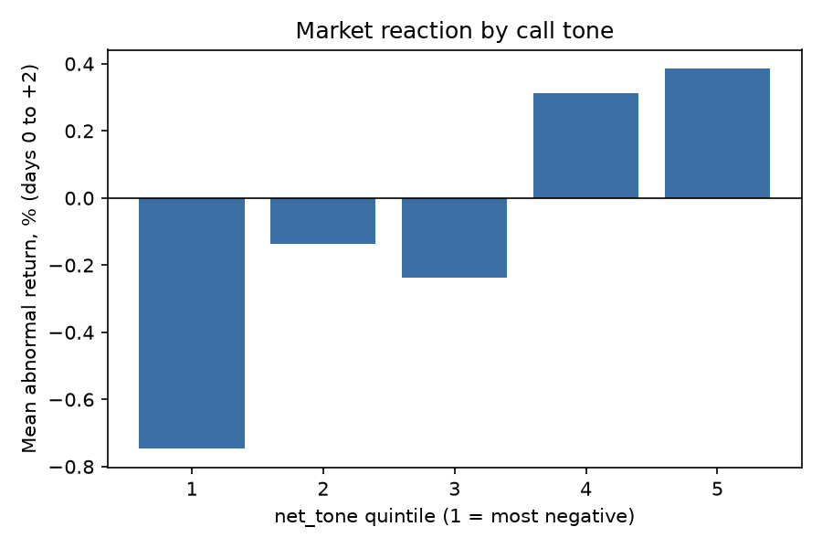

# Do earnings-call words move stocks?

A reproducible pipeline that scores earnings-call transcripts for tone, uncertainty, hedging and evasiveness, measures the stock's 3-day abnormal return around each call, and tests whether the language lines up with the market reaction. Built with Python (pandas, statsmodels, scikit-learn); runs from the terminal.

## Headline result
- **Q&A tone is statistically significant but economically small.** A 1 SD more positive Q&A tone goes with about +0.39 percentage points of 3-day abnormal return (t = 3.90, ticker-clustered).
- **Calls in the most negative-tone quintile averaged -0.75% and the most positive +0.39%**, a 1.13% spread (Welch t = 3.82).
- **Call language explains under 1% of return variation** (R-squared 0.65%), and **out-of-sample predictive power is essentially zero** (R-squared 0.0001, direction hit rate 51.8%). This is an association, not a trading signal.

## Data and method
- **Transcripts:** the MIT-licensed Hugging Face dataset kurry/sp500_earnings_transcripts. Sample: 100 randomly chosen S&P 500 tickers (seed 0), 2016-2024. 3,339 calls with a detectable Q&A section, 3,106 with price data.
- **Market reaction:** stock return minus SPY, summed over trading days 0 to +2 from the first trading day on or after the call; shifted one day for calls starting at or after 4pm (timestamps assumed US Eastern). Prices from Yahoo Finance via yfinance.
- **Text features:** Loughran-McDonald positive/negative/uncertainty word shares (prepared remarks and Q&A scored separately), hedge-phrase and evasive-phrase rates in the Q&A, transcript length.
- **Tests:** OLS on standardized features with ticker-clustered standard errors (plus VIF check), quintile sort, and a time-split out-of-sample test (train on the earliest 70% of calls, test on the latest 30%).

## Results (Loughran-McDonald dictionary)
| Feature | Effect per 1 SD | t | p |
|:--|--:|--:|--:|
| Q&A net tone | +0.39 pp | 3.90 | 0.0001 |
| Prepared-remarks net tone | +0.17 pp | 2.12 | 0.034 |
| Q&A uncertainty | +0.15 pp | 1.41 | 0.158 |
| Q&A hedge rate | -0.03 pp | -0.32 | 0.747 |
| Q&A evasive rate | +0.02 pp | 0.19 | 0.852 |
| Transcript length (log) | -0.09 pp | -0.92 | 0.355 |

**Robustness:** a smaller hand-built word list gave the same Q&A result (t = 3.84, spread 1.12%). Prepared-remarks tone was not significant under it (p = 0.19), so I treat that coefficient as unreliable. Full reports are in results/.

## Limitations
- **Association, not forecast.** Many calls start after the earnings release, so day 0 can already include the reaction to the numbers.
- **Earnings surprise is not controlled for.** Tone may simply proxy for good or bad results.
- **Q&A text includes analysts' questions,** not only management's answers.
- **Survivorship bias.** The data covers current S&P 500 constituents; 233 calls had no price data (mostly acquired or delisted companies).
- **Simple benchmark.** Market-adjusted returns, not a Fama-French factor model.
- **Multiple testing.** Six features were tested; lexicon methods ignore context and negation.
- Tone is not a tradable strategy: no transaction costs, and the out-of-sample test shows no reliable edge.

## Reproduce
    pip install -r requirements.txt
    python -m pytest -q tests
    python patch_features.py
    python make_dataset.py
    python run.py run --transcripts data/calls.csv --lm-dict data/LM_MasterDictionary.csv

Download the Loughran-McDonald Master Dictionary CSV from https://sraf.nd.edu/loughranmcdonald-master-dictionary/ and save it as data/LM_MasterDictionary.csv (free for non-commercial research; not redistributed here). Add --finbert to also score with FinBERT (needs torch and transformers). `python run.py demo` runs on synthetic data to check the pipeline; its planted relationship is not a finding.

## Next steps
Separate management answers from analyst questions using speaker labels, control for earnings surprise, test a post-call drift window (days +1 to +3), and add Fama-French factors.
