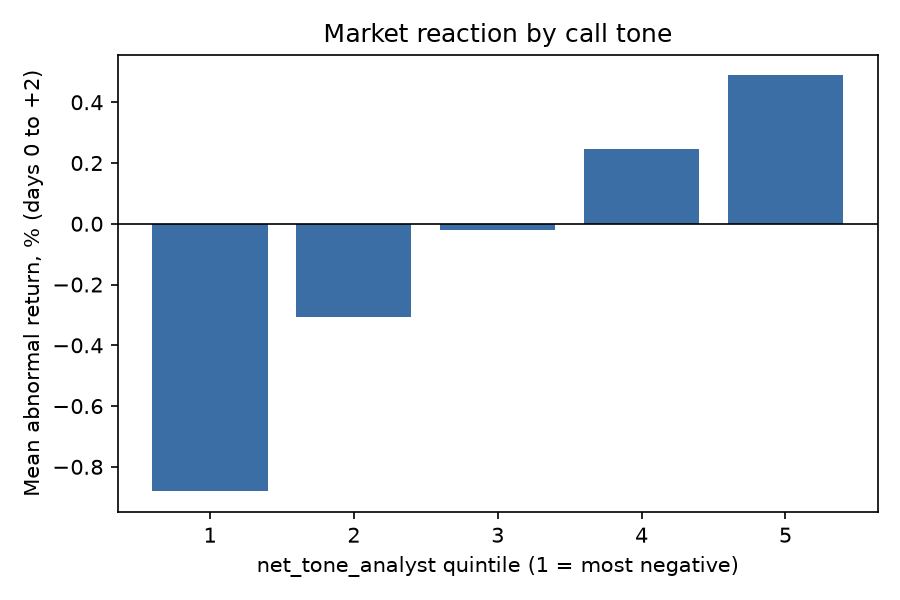
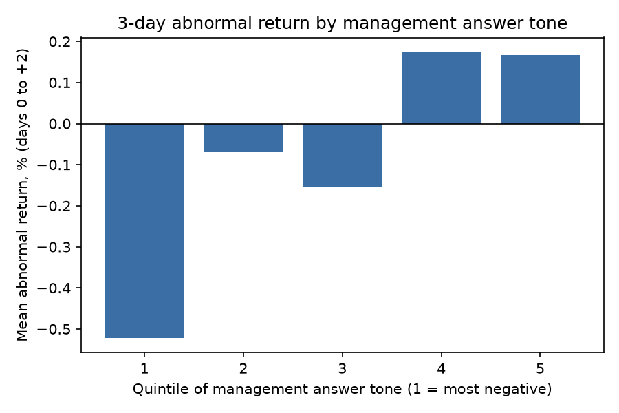

# Do earnings-call words move stocks?

A reproducible pipeline that scores earnings-call transcripts for tone, uncertainty, hedging and evasiveness, separates what analysts say from what management says, and tests whether the language lines up with the stock's 3-day abnormal return around each call. Built with Python (pandas, statsmodels, scikit-learn); runs from the terminal.

## Headline result
- **Analyst question tone is the strongest language signal, and management's answers add nothing once it is controlled for.** A 1 SD more positive analyst tone goes with about +0.47 percentage points of 3-day abnormal return (t = 3.43, ticker-clustered), controlling for management tone and hedging. Management tone is not significant once analyst tone is included (t = 0.73).
- **The pattern is monotonic across analyst-tone quintiles:** from -0.88% (most negative) to +0.49% (most positive), a 1.37% spread (Welch t = 4.63).
- **Language explains about 1% of return variation (R-squared 1.06%).** Out-of-sample, the top third of predictions beat the bottom third by 1.10 pp, but direction hit rate is only 51.5% and out-of-sample R-squared is 0.7%. This is an association, not a tradable signal.
- **One plausible reading:** analysts' tone partly reflects the earnings news itself, which the stock also reacts to. I have not tested that directly (see limitations).

 

## Data and method
- **Transcripts:** the MIT-licensed Hugging Face dataset kurry/sp500_earnings_transcripts (S&P 500 constituents and related US large-caps; the dataset card says research and educational use only). Sample: 100 tickers drawn at random (seed 0) from those with at least 20 calls in 2016-2024. 3,339 calls with a detectable Q&A section, 3,106 with price data, 3,060 with complete text features.
- **Speaker split:** the Q&A starts at the first operator turn that mentions questions after management has spoken. Anyone who spoke before the Q&A is management; anyone the operator hands the floor to is an analyst; remaining speakers count as analysts only if at least 25% of their turns contain a question mark.
- **Market reaction:** stock return minus SPY, summed over trading days 0 to +2 from the first trading day on or after the call; shifted one day for calls starting at or after 4pm (timestamps assumed US Eastern). Abnormal returns are winsorized at the 1st and 99th percentiles. Prices from Yahoo Finance via yfinance.
- **Text features:** Loughran-McDonald positive/negative/uncertainty word shares for prepared remarks, management answers and analyst questions, plus hedge-phrase and evasive-phrase rates in management answers and transcript length.
- **Tests:** OLS on standardized features with ticker-clustered standard errors (plus VIF check), quintile sorts, and a time-split out-of-sample test (ridge regression trained on the earliest 70% of calls, tested on the latest 30%).

## Results (Loughran-McDonald dictionary)
| Feature | Effect per 1 SD | t | p |
|:--|--:|--:|--:|
| Analyst question tone | +0.47 pp | 3.43 | 0.0006 |
| Prepared-remarks tone | +0.20 pp | 2.35 | 0.019 |
| Management answer tone | +0.09 pp | 0.73 | 0.465 |
| Management uncertainty | +0.08 pp | 0.80 | 0.426 |
| Management hedge rate | 0.00 pp | -0.01 | 0.995 |
| Management evasive rate | -0.01 pp | -0.11 | 0.914 |
| Transcript length (log) | -0.07 pp | -0.69 | 0.488 |

Management tone on its own has a 0.69% top-minus-bottom quintile spread (t = 2.26), but the gap comes mostly from the bottom quintile (-0.52%, versus -0.15% to +0.17% for the other four) and the effect disappears once analyst tone is controlled. Management and analyst tone correlate at 0.31.

**Robustness:** before the speaker split, Q&A tone had t = 3.90 in the regression and overall call tone had a 1.13% quintile spread; a smaller hand-built word list gave the same pattern (t = 3.84, 1.12%). Three specifications were run in total (small word list, Loughran-McDonald, speaker split) and all are reported. Prepared-remarks tone is unstable across specifications (p from 0.19 to 0.002), and does not clear a multiple-testing correction across seven features, so I do not rely on it. Full reports are in results/.

## Limitations
- **Association, not forecast.** Many calls start after the earnings release, so day 0 can already include the reaction to the numbers.
- **Earnings surprise is not controlled for.** Analyst tone may simply proxy for good or bad results.
- **Roles are inferred** from speaking order and question marks, so some turns may be mislabelled; an early version that ignored the operator counted executives who only join the Q&A as analysts; correcting it moved the estimates modestly (analyst-tone t from 3.04 to 3.43) and did not change the conclusion.
- **Survivorship bias.** 233 of 3,339 calls had no price data: 134 came from five companies that were acquired or failed (JNPR, FRC, NLSN, CERN, KSU), 93 from three still-listed tickers for which Yahoo Finance returned nothing (EQR, QRVO, LEG), and 6 from IR. The price-matched sample therefore leans toward survivors; I have not measured the effect on the results.
- **Simple benchmark.** Market-adjusted returns, not a Fama-French factor model.
- **Multiple testing.** Seven features were tested; lexicon methods ignore context and negation.
- **Text and timing details.** Prepared-remarks tone is scored on text that still includes speaker labels and operator boilerplate. Call timestamps are assumed US Eastern, and a few calls carry midnight timestamps and are treated as pre-market.
- **Not a trading strategy:** no transaction costs, and individual-call direction is barely better than a coin flip.

## Reproduce
    pip install -r requirements.txt
    python -m pytest -q tests
    python make_dataset.py
    python run.py run --transcripts data/calls.csv --lm-dict data/LM_MasterDictionary.csv

Download the Loughran-McDonald Master Dictionary CSV from https://sraf.nd.edu/loughranmcdonald-master-dictionary/ and save it as data/LM_MasterDictionary.csv (free for non-commercial research; not redistributed here). An experimental --finbert option exists (needs torch and transformers) but was not used for the results above. `python run.py demo` runs on synthetic data to check the pipeline; its planted relationship is not a finding.

## Next steps
List which words drive analyst tone, control for earnings surprise, test a post-call drift window (days +1 to +3), and add Fama-French factors.
